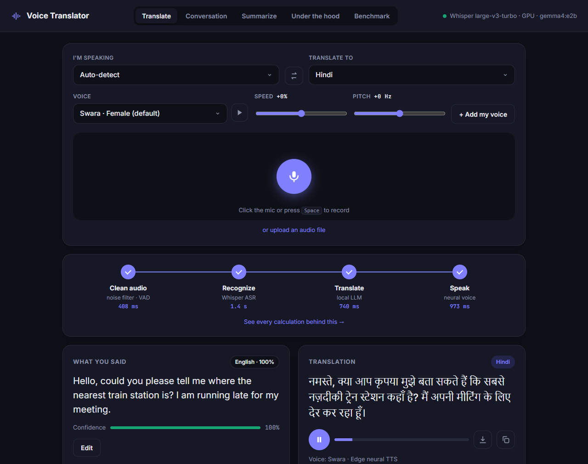
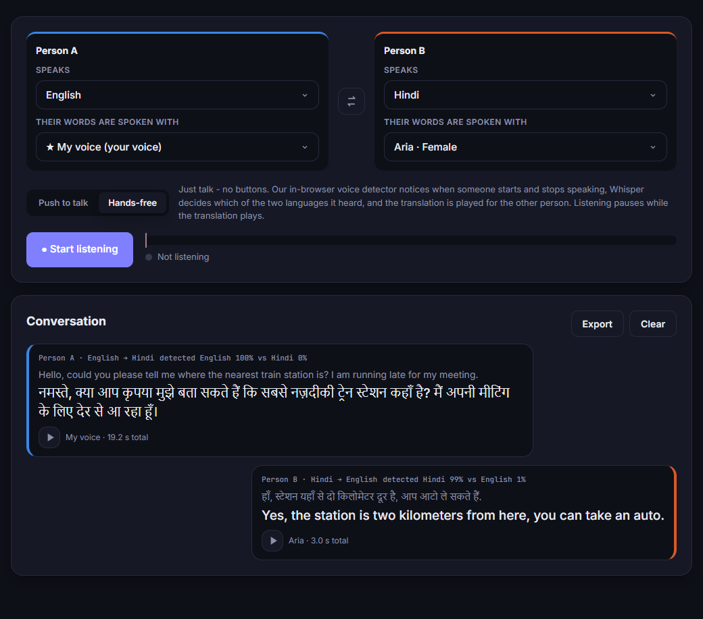
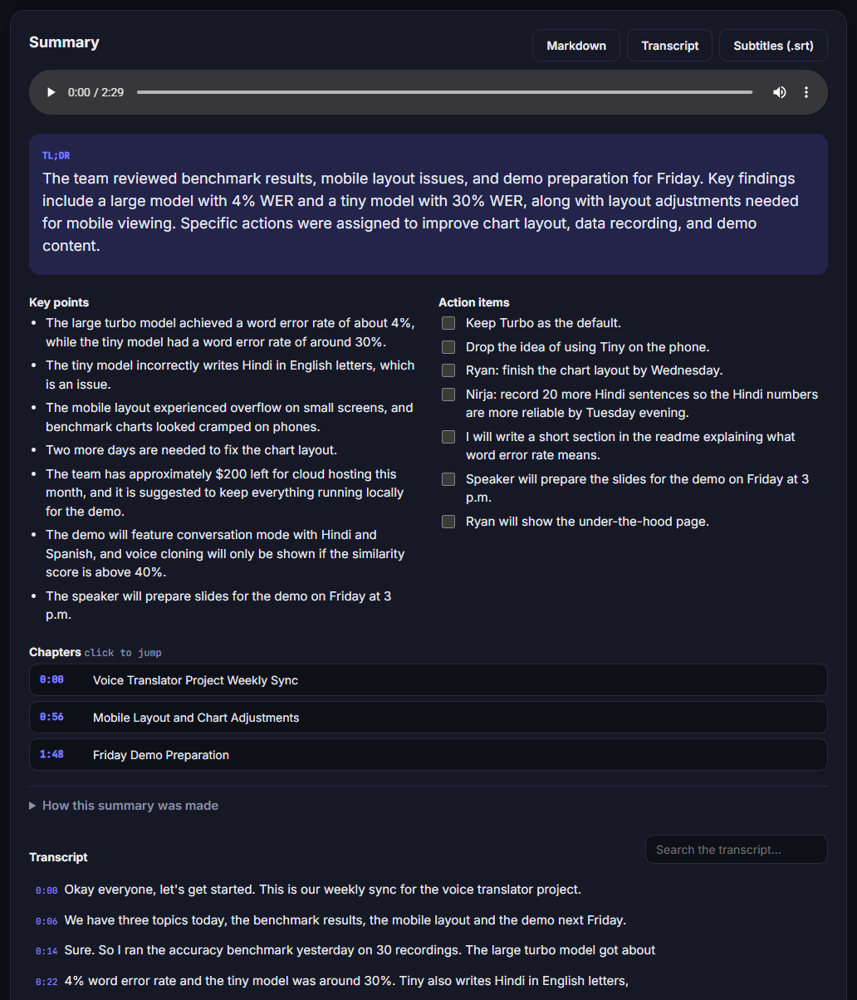
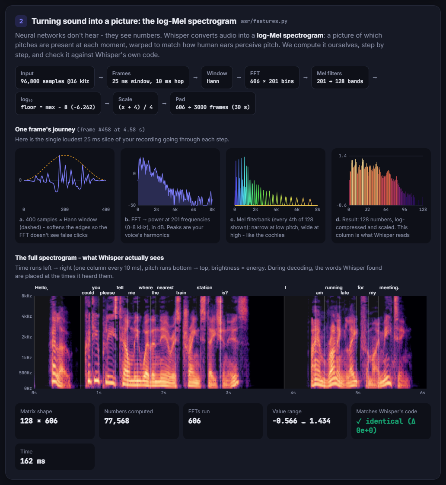
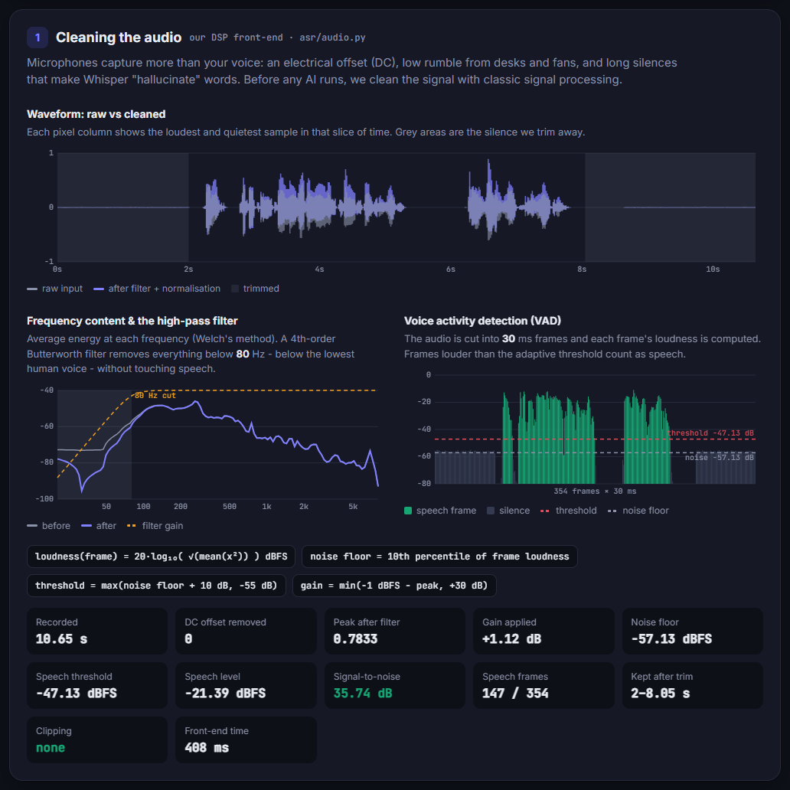
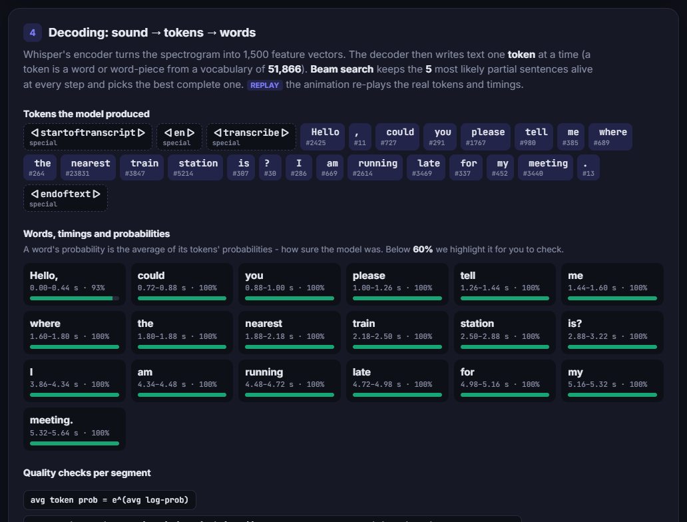
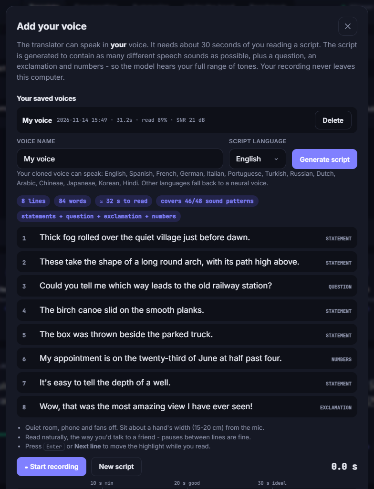
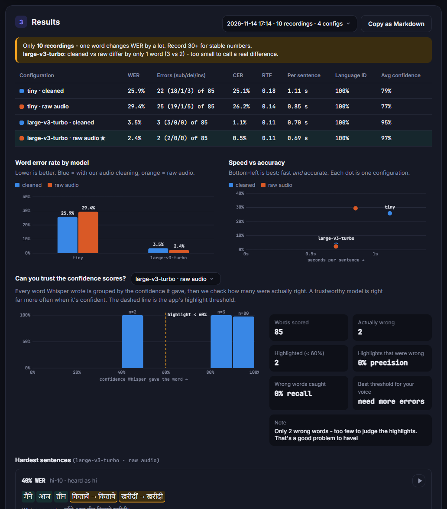

# Voice Translator - ASR + Translation

[](https://github.com/TheRajveerSingh/Automatic-Speech-Recognition-A-live-language-translator/actions/workflows/tests.yml)

A local speech-recognition app: speak in one language, hear it in another - in a neural voice or **your own
cloned voice**. Hold two-way conversations, summarise hour-long recordings, and measure the ASR's accuracy on
your own voice. Everything except the Edge voices runs on your own GPU.

📖 **For more detailed information, go to this file: [Detailed Information about the Project](Detailed-Information-about-the-Project.md)**, a screen-by-screen walkthrough of the app and an explanation of every file.

```
mic ─► Clean audio ─► log-Mel ─► Recognize ─► Translate ─► Speak
       (our DSP+VAD)  (our code)  (Whisper)   (Ollama LLM)  (Edge voices / XTTS your voice)
```



## Screenshots
| | |
|---|---|
| **Conversation** - two people, two languages; hands-free mode detects who is speaking<br> | **Summarize** - TL;DR, action items and clickable chapters from a meeting video<br> |
| **Under the hood: log-Mel** - our own feature extraction, verified identical to Whisper's<br> | **Under the hood: cleaning** - filter response and frame-by-frame voice activity detection<br> |
| **Under the hood: decoding** - language probabilities, tokens and per-word confidence<br> | **Add my voice** - generated phonetically-rich script for voice cloning<br> |

**Benchmark** - WER / CER / speed per model, with and without our audio cleaning, plus confidence calibration.
_(This example run uses 10 sentences read by generated test voices - see [Accuracy on my voice](#accuracy-on-my-voice) for real numbers.)_



## Features (one tab each)
| Tab | What it does |
|---|---|
| **Translate** | Record → transcript with uncertain words highlighted (editable) → live-streamed translation → speech. 22 languages, voice / speed / pitch picker. |
| **Conversation** | Two people, two languages. Push-to-talk, or **hands-free**: our in-browser VAD detects when someone speaks and Whisper decides which of the two languages it was. |
| **Summarize** | Upload audio **or video** (up to 3 h) or record live → streamed transcript → TL;DR, key points, action items, clickable chapters (map-reduce with the local LLM) → export .md / .txt / .srt. |
| **Under the hood** | Every calculation of the last recording visualised: filtering, VAD frames, the log-Mel steps, spectrogram with words, language probabilities, tokens, word confidence, LLM prompt & stats. |
| **Benchmark** | Record a test set in your voice, then measure **WER / CER / speed / language-ID** for several Whisper models, with and without our audio cleaning, plus confidence calibration. |
| **+ Add my voice** | Generated phonetically-rich reading script → recording checked by our ASR → XTTS-v2 voice clone (17 languages) with a similarity score. |

## What's built here (not just API calls)
| Part | File | What it does |
|---|---|---|
| Audio front-end | `asr/audio.py` | DC removal, 80 Hz Butterworth high-pass, capped normalisation, adaptive energy VAD with hangover, silence trimming, SNR/clipping report. |
| Features | `asr/features.py` | Step-by-step log-Mel spectrogram, verified identical to Whisper's own. |
| Recogniser | `asr/transcriber.py` | faster-whisper `large-v3-turbo`: language ID (also restricted to a language pair), tokens, word confidence, streaming for long audio. |
| Metrics | `asr/metrics.py` | WER/CER with word alignment and normalisation (numbers, times, contractions, Hindi spelling variants). |
| Benchmark | `eval/evaluate_wer.py` | Test-set storage, multi-model runs, calibration (precision/recall of highlights, best threshold). |
| Translation | `translation/translator.py` | Local `gemma4:e2b` via Ollama, streamed. |
| Summaries | `summarize/summarizer.py` | Map-reduce summarisation with JSON-schema structured output. |
| Speech | `tts/speaker.py`, `tts/cloner.py`, `tts/enroll.py` | Edge voices, XTTS-v2 cloning (own number spelling for Hindi/Chinese), enrolment script + checks. |
| Browser VAD | `static/conversation.js` | AudioWorklet capture, adaptive noise floor, pre-roll, end-of-turn detection, WAV encoding. |

## Setup (one time)
```bash
conda create -n asr-translate -c conda-forge --override-channels python=3.11 ffmpeg -y
conda activate asr-translate
pip install -r requirements.txt
pip install -r requirements-voice.txt   # optional: your-own-voice feature (~3 GB)
ollama pull gemma4:e2b                  # skip if `ollama list` already shows it
python check_setup.py                   # everything should say [ OK ]
```
Optional: copy `.env.example` to `.env` to change models, port, etc. Whisper (~1.5 GB) and XTTS-v2 (~1.75 GB)
download automatically on first use.

## Run
```bash
conda activate asr-translate
python server.py
```
Open http://localhost:8000 in Chrome or Edge and wait for the green dot.

- Terminal translation test: `python pipeline.py some_audio.wav hi`
- Terminal benchmark: `python -m eval.evaluate_wer --models tiny,small,large-v3-turbo`

## Tests
68 automated tests cover the logic that doesn't need a GPU: WER/CER scoring and text normalisation, number spelling
for Hindi/Chinese voice cloning, the audio front-end (filter, normalisation, VAD) on synthetic signals, the voice-enrolment
script and checks, transcript chunking for summaries, and the translation prompt's safeguards. They run on GitHub on every push (badge above).
```bash
pip install -r requirements-dev.txt
pytest
```

## Accuracy on my voice
_Coming soon: measured on my own recordings with the Benchmark tab (30+ sentences)._
<!-- Benchmark tab → record ~30 sentences → Run → "Copy as Markdown" → paste the table here -->

These numbers describe one speaker, one microphone and one room - not Whisper in general.

## GPU memory (RTX 4060 Laptop, 8 GB)
Whisper + Gemma ≈ 3.9 GB; with XTTS loaded too ≈ 6.3 GB.

## Privacy & git
`voices/` (your voice), `eval/datasets/` (your recordings), `outputs/`, `models/` and `.env` are git-ignored.
Generated audio in `outputs/` is deleted automatically after 24 h (`OUTPUT_MAX_AGE_HOURS`).

## Known limitations
- No speaker identification: summaries say "Speaker"/"I" when a task isn't tied to a name.
- Conversation hands-free mode works best with headphones (speaker echo can trigger the VAD).
- Edge voices need internet; everything else is offline.
- Your-own-voice (XTTS) is the slowest step: roughly 1-2 s per second of speech on a laptop GPU. On some laptops the
  NVIDIA driver lowers the GPU clock during XTTS; setting **NVIDIA Control Panel → Manage 3D settings → Power management
  mode → Prefer maximum performance** for `python.exe` can help.

## Removing the voice-cloning feature (frees ~4.5 GB)
```bash
pip uninstall -y coqui-tts coqui-tts-trainer torch torchaudio torchcodec
```
Then delete `%USERPROFILE%\.cache\huggingface\hub\models--tts-hub--XTTS-v2` and this project's `models/` folder.

## Licence
The code is released under the [MIT License](LICENSE). The AI models it downloads keep their own licences:
Whisper (MIT), Gemma ([Gemma Terms of Use](https://ai.google.dev/gemma/terms)) and XTTS-v2
([Coqui Public Model License](https://coqui.ai/cpml) - **non-commercial use only**).

